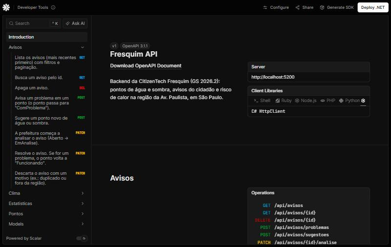
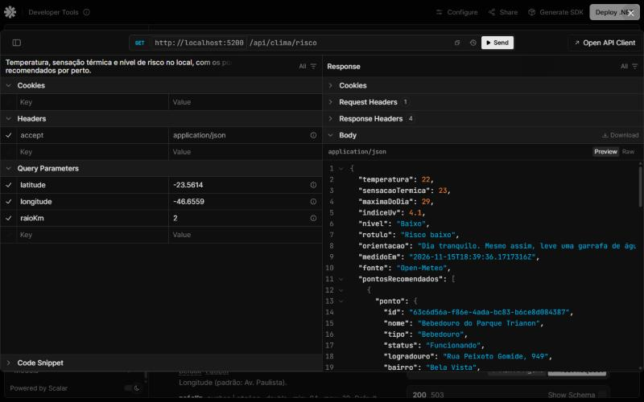

<p align="center">
  
</p>

<h1 align="center">Fresquim API</h1>

<p align="center">GS 2026.2 · CitizenTech · C# Software Development</p>

## Integrantes

| Nome | RM |
|---|---|
| Leonardo Rocha Scarpitta | RM555460 |
| Gustavo Morais Ildefonso | RM554972 |
| Murilo Justi Rodrigues | RM554512 |
| Vitor Alves Titus Eskes | RM555137 |

## A solução

**Problema:** em dias de calor extremo, idosos e trabalhadores de rua da região da Av. Paulista (São Paulo) não sabem quando o risco está alto nem onde encontrar água e sombra perto deles. Quando um bebedouro quebra, ninguém fica sabendo.

**Fresquim** é a CitizenTech que resolve isso. Esta API é o **backend** dela:

- **Pontos de apoio:** cadastro e consulta de bebedouros, sombras, postos de saúde e estações, com busca, filtros e "mais perto de mim".
- **Risco de calor:** consulta a temperatura e a sensação térmica na [Open-Meteo](https://open-meteo.com) (API pública e gratuita), classifica o risco (Baixo, Atenção ou Perigo) e recomenda os pontos certos para aquele nível.
- **Avisos do cidadão:** o morador avisa um problema ("bebedouro sem água") ou sugere um ponto novo. A prefeitura analisa e resolve, e o ponto volta a funcionar automaticamente.
- **Indicadores de impacto:** total de pontos disponíveis, avisos resolvidos, tempo médio de resolução e um resumo por bairro.

**ODS:** 3 (Saúde e bem-estar), 11 (Cidades sustentáveis) e 13 (Ação contra a mudança do clima).

## Tecnologias

| | |
|---|---|
| Linguagem / framework | C# 14, .NET 10, ASP.NET Core Web API (controllers) |
| Banco | Entity Framework Core 10 + SQLite (arquivo local, sem senha) |
| Documentação | OpenAPI 3.1 + [Scalar](https://scalar.com) |
| Testes | xUnit + Moq + SQLite em memória |
| API externa | Open-Meteo (sem chave) |

Tudo é gratuito, e não há nenhuma chave, senha ou segredo no repositório.

## Como executar

Pré-requisito: [.NET SDK 10](https://dotnet.microsoft.com/download).

```bash
git clone https://github.com/La-Elvis-Tech-2/gs_c_fresquim.git
cd gs_c_fresquim
dotnet run --project src/Fresquim.Api
```

Depois abra **http://localhost:5200/scalar** para ver e testar os endpoints.

Na primeira execução a API cria o banco `fresquim.db` pelas **migrations** e cadastra 8 pontos de exemplo da região da Av. Paulista. Não é preciso configurar nada.

**Rodar os testes:**

```bash
dotnet test
```

**Recriar a migration (opcional):**

```bash
dotnet tool restore
dotnet ef migrations add NomeDaMigration -p src/Fresquim.Infrastructure -s src/Fresquim.Api -o Persistence/Migrations
```

O arquivo [`src/Fresquim.Api/Fresquim.Api.http`](src/Fresquim.Api/Fresquim.Api.http) tem exemplos prontos de todas as requisições (VS Code com REST Client ou Visual Studio).

## Arquitetura

Projeto em camadas (Clean Architecture simplificada). As dependências apontam sempre para dentro: o domínio não conhece banco nem HTTP.

```
src/
├── Fresquim.Domain          # Entidades, objetos de valor e regras de negócio (POO)
├── Fresquim.Application     # Casos de uso (services), DTOs e interfaces (repositórios, clima)
├── Fresquim.Infrastructure  # EF Core (DbContext, mapeamentos, migrations, repositórios) e cliente Open-Meteo
└── Fresquim.Api             # Controllers REST, tratamento de erros, OpenAPI/Scalar e injeção de dependência
tests/
└── Fresquim.Tests           # Testes de domínio, serviços (Moq) e repositórios (SQLite em memória)
```

```
Api ──► Application ──► Domain
 │            ▲
 └──► Infrastructure (implementa as interfaces da Application)
```

## Como cada conteúdo da disciplina foi aplicado

### Programação Orientada a Objetos

- **Herança e abstração:** `PontoApoio` é uma classe abstrata com as subclasses `Bebedouro`, `Sombra`, `PostoSaude` e `Estacao`. Todas herdam de `Entidade` (Id e datas).
- **Polimorfismo:**
  - cada tipo sobrescreve `Tipo`, `Dica` e `RecomendadoPara(NivelRisco)`;
  - um posto de saúde só é recomendado a partir de "Atenção";
  - em "Perigo", só entram sombras para 10 pessoas ou mais;
  - o `ClimaService` chama `RecomendadoPara` sem saber qual é o tipo concreto.
- **Encapsulamento:**
  - todas as propriedades têm `private set`;
  - o estado só muda por métodos que validam as regras (`ReportarProblema`, `Desativar`, `IniciarAnalise`, `Resolver`...);
  - não dá para resolver um aviso já finalizado nem reportar problema num ponto desativado.
- **Objetos de valor:** `Coordenada` (com cálculo de distância por Haversine) e `Endereco` são `records` imutáveis que se validam no construtor.
- **Factory Method:** `Aviso.ReportarProblema(...)`, `Aviso.SugerirPonto(...)` e `PontoMapper.CriarEntidade(...)` criam o objeto certo a partir do tipo.

### Interfaces e Injeção de Dependência

- **Interfaces da Application:** `IPontoApoioRepository`, `IAvisoRepository`, `IUnitOfWork` e `IClimaProvider`. Os serviços dependem só delas.
- **Interfaces dos serviços:** `IPontoApoioService`, `IAvisoService`, `IClimaService` e `IEstatisticasService`, usados pelos controllers.
- **Registro:** cada camada tem seu método de extensão (`AddApplication()` e `AddInfrastructure()`). O `HttpClient` da Open-Meteo é tipado e vem do `IHttpClientFactory`.
- **Testes:** as interfaces permitem trocar as implementações por mocks (Moq).

### Entity Framework Core + LINQ

- **Mapeamento:**
  - `FresquimDbContext` com mapeamentos em classes `IEntityTypeConfiguration`;
  - a herança vira uma tabela só (**TPH**), com discriminador `TipoPonto`;
  - endereço e coordenada são gravados como **complex types**;
  - enums viram texto no banco, e todas as datas são tratadas como UTC.
- **Migrations:** em `Infrastructure/Persistence/Migrations`, aplicadas automaticamente na inicialização. Ao remover um ponto, os avisos ligados a ele ficam no histórico sem o vínculo (`OnDelete(SetNull)`).
- **LINQ no banco** (traduzido para SQL):
  - filtros opcionais por tipo, status, bairro e busca com `EF.Functions.Like`;
  - paginação com `Skip`/`Take`;
  - `Include`, `AnyAsync` e `CountAsync`;
  - pré-filtro geográfico por latitude e longitude.
- **LINQ em memória:**
  - distância exata, ordenação e `Take`;
  - estatísticas com `GroupBy`, `GroupJoin`, `Average` e `OfType`.

### Programação assíncrona

- Toda a cadeia é `async`/`await`: controllers, serviços, repositórios (`ToListAsync`, `FirstOrDefaultAsync`, `SaveChangesAsync`) e cliente HTTP (`GetFromJsonAsync`).
- O `CancellationToken` da requisição chega até o banco e a API externa.
- O `ClimaService` consulta a Open-Meteo e o banco **em paralelo** com `Task.WhenAll`.
- Migrations e seed rodam de forma assíncrona na inicialização.

### Web API REST

- **Rotas e status:**
  - rotas por recurso e verbos HTTP corretos (GET, POST, PUT, PATCH, DELETE);
  - `201 Created` com `Location`, `204 No Content`, `400`, `404` e `503`;
  - enums aparecem como texto no JSON.
- **Validação:** DataAnnotations nos DTOs geram `400` automático. As regras de negócio também viram `400`, com a mensagem do domínio.
- **Erros:** respostas no padrão **ProblemDetails (RFC 9457)**, montadas por um `IExceptionHandler` global.
- **Documentação:** comentários XML aparecem no Scalar.

### Testes unitários (61 testes)

| Arquivo | O que testa |
|---|---|
| `Domain/CoordenadaTests` | Distância Haversine, simetria e limites de latitude/longitude |
| `Domain/RiscoCalorTests` | Faixas de risco e uso da sensação térmica |
| `Domain/PontoApoioTests` | Polimorfismo (tipo, dica e recomendação por nível), status e validações |
| `Domain/AvisoTests` | Criação, transições de status e ponto voltando a funcionar |
| `Application/*ServiceTests` | Serviços com Moq: não encontrado, duplicidade, subclasse criada, ordenação por distância, estatísticas |
| `Infrastructure/PontoApoioRepositoryTests` | Consultas LINQ reais em SQLite em memória: discriminador, filtros combinados, busca, paginação, região e `SetNull` |

## Endpoints

Documentação interativa em **`/scalar`** e especificação OpenAPI em **`/openapi/v1.json`**.

| Método | Rota | Descrição |
|---|---|---|
| GET | `/api/clima/risco?latitude=&longitude=&raioKm=` | Temperatura, nível de risco e pontos recomendados por perto |
| GET | `/api/pontos?tipo=&status=&bairro=&busca=&pagina=&tamanhoPagina=` | Lista paginada com filtros |
| GET | `/api/pontos/{id}` | Detalhe de um ponto |
| GET | `/api/pontos/proximos?latitude=&longitude=&raioKm=&tipo=` | Pontos disponíveis mais perto, ordenados pela distância |
| POST | `/api/pontos` | Cadastra um ponto (o campo `tipo` define a subclasse) |
| PUT | `/api/pontos/{id}` | Edita um ponto |
| PATCH | `/api/pontos/{id}/status` | Muda o status (Funcionando, ComProblema ou Desativado) |
| DELETE | `/api/pontos/{id}` | Remove um ponto |
| GET | `/api/avisos?tipo=&status=&pontoApoioId=` | Lista paginada de avisos |
| GET | `/api/avisos/{id}` | Detalhe de um aviso |
| POST | `/api/avisos/problemas` | Avisa um problema (o ponto fica "ComProblema") |
| POST | `/api/avisos/sugestoes` | Sugere um ponto novo |
| PATCH | `/api/avisos/{id}/analise` | Aberto → EmAnalise |
| PATCH | `/api/avisos/{id}/resolver` | Resolve (o ponto volta a "Funcionando") |
| PATCH | `/api/avisos/{id}/descartar` | Descarta com motivo |
| DELETE | `/api/avisos/{id}` | Apaga um aviso |
| GET | `/api/estatisticas` | Indicadores de impacto |

**Exemplo:** cadastrar uma sombra.

```http
POST /api/pontos
Content-Type: application/json

{
  "tipo": "Sombra",
  "nome": "Praça do MASP",
  "logradouro": "Avenida Paulista, 1578",
  "bairro": "Bela Vista",
  "latitude": -23.5614,
  "longitude": -46.6559,
  "horario": "Aberto 24 horas",
  "capacidadePessoas": 40
}
```

**Exemplo de erro** (regra de negócio):

```json
{
  "title": "Regra de negócio violada",
  "status": 400,
  "detail": "Já existe um aviso em aberto para este ponto. Obrigado por avisar!"
}
```

### Regra de risco de calor

Vale a maior medida entre temperatura e sensação térmica (a mesma regra do app Fresquim):

| Temperatura de referência | Nível |
|---|---|
| abaixo de 30 °C | Baixo |
| de 30 °C a 34 °C | Atenção |
| 35 °C ou mais | Perigo |

## Evidências de funcionamento

**Documentação Scalar com todos os endpoints:**



**Requisição real ao `GET /api/clima/risco`** (dados ao vivo da Open-Meteo e pontos recomendados vindos do banco):



**Testes:** os 61 testes passando estão listados em [`docs/evidencias/3-testes.txt`](docs/evidencias/3-testes.txt).

## Dados

- **Pontos:** os endereços são de locais públicos reais da região da Av. Paulista. Horários, status e detalhes (água gelada, capacidade etc.) são **simulados**.
- **Clima:** dados públicos da Open-Meteo.
- Nenhum dado pessoal real é usado.
